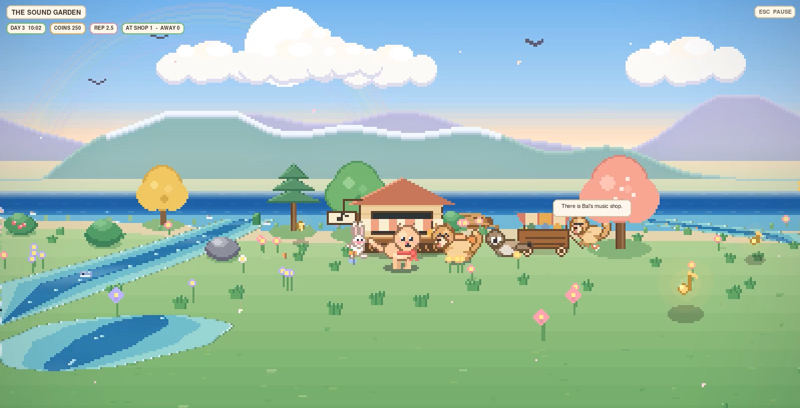
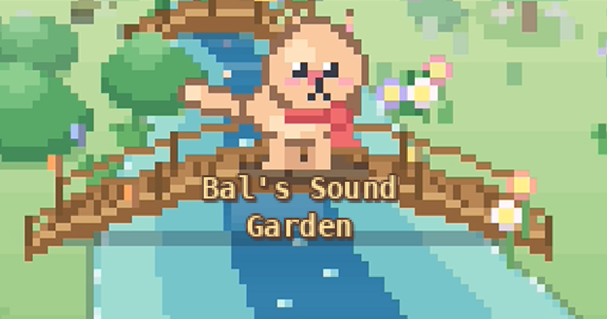
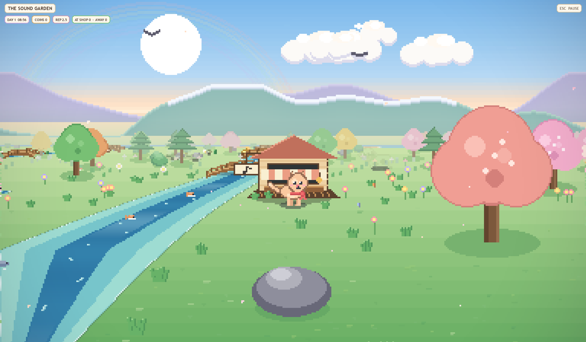
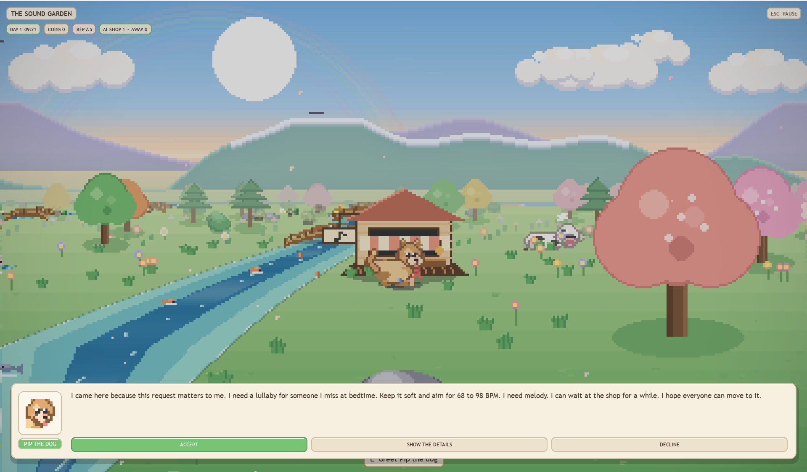
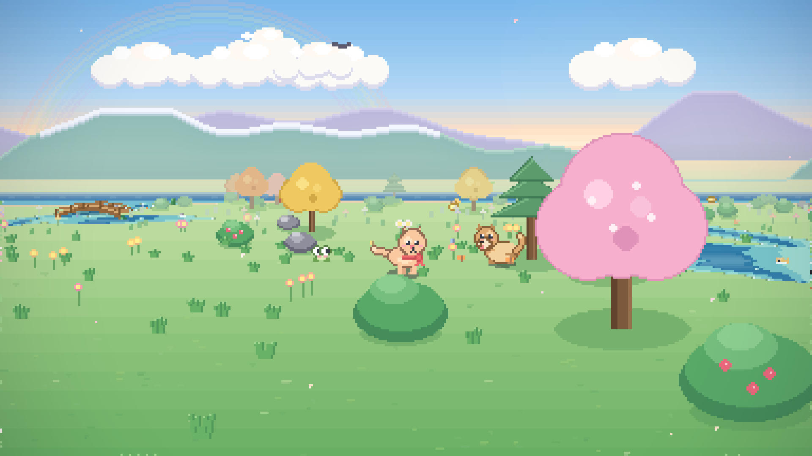
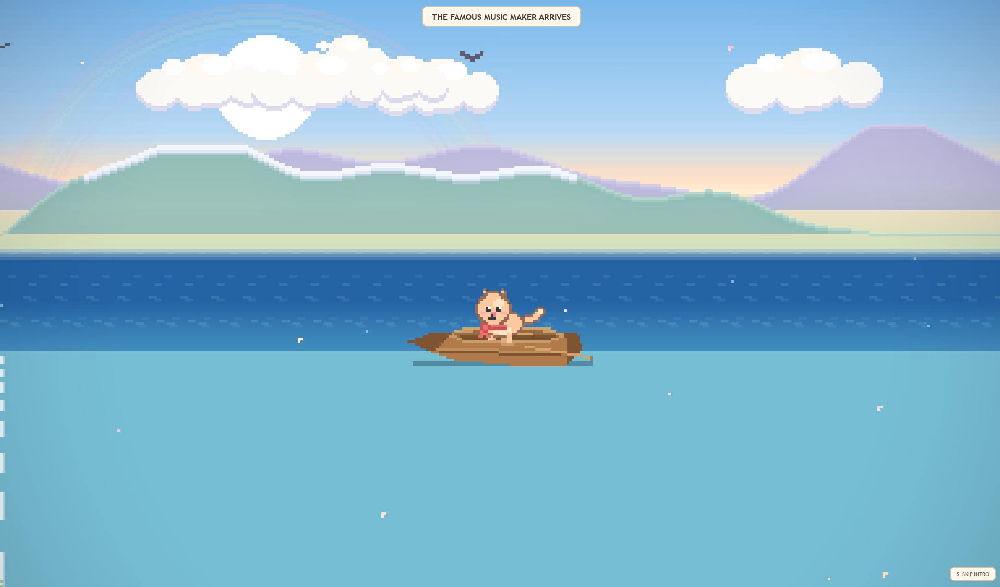
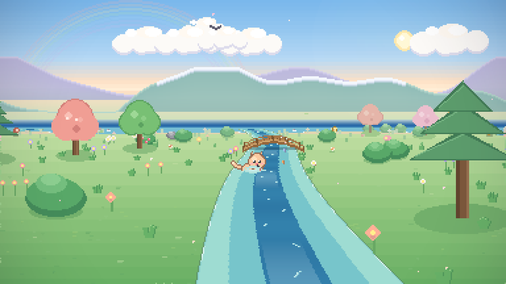
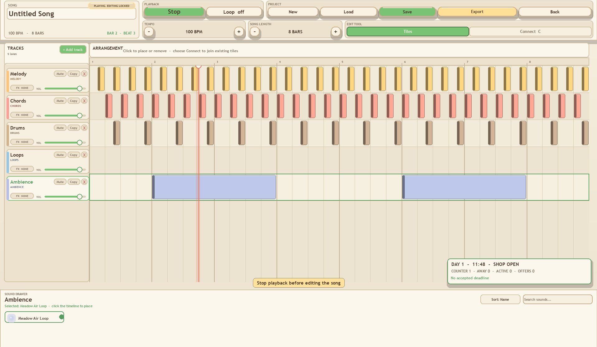
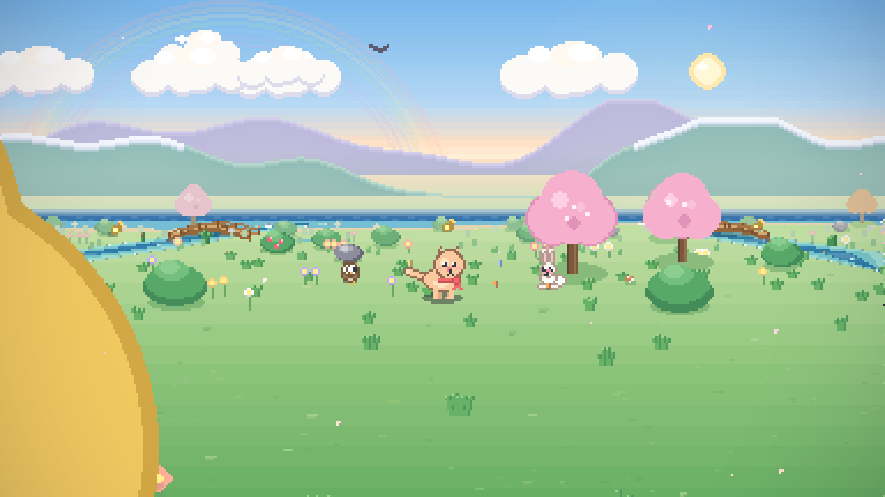
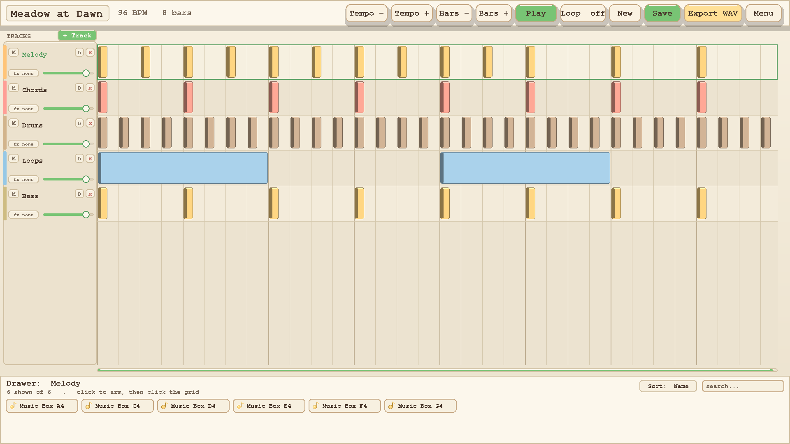

# Bal's Sound Garden

**A music-making adventure built in Python, Pygame and NumPy.** Explore a procedurally drawn island as Bal, discover musical components, compose songs, and run a small music shop for animal visitors. This repository documents and preserves the **source code**; the downloadable Windows, macOS and Linux builds are distributed exclusively through itch.io.

**[Project website](https://alibaki89.github.io/Bals-Sound-Garden/)** · **[Download / play on itch.io](https://abprojects.itch.io/bals-sound-garden)** · **[Engineering report](docs/TECHNICAL_REPORT.pdf)** · **[Architecture](docs/ARCHITECTURE.md)** · **[How to play](docs/HOW_TO_PLAY.md)** · **[Build instructions](BUILDING.md)**



## The project

Bal's Sound Garden connects three playable systems: an explorable 2.5D island that produces collectible sound components; a multitrack Music Maker that can arrange, play and export those sounds; and a persistent shop simulation with customers, requests, deadlines, reputation, upgrades and helpers. **Story** and **Explore** are independent ways to play.

| Area | Implementation |
|---|---|
| Desktop application | Python + Pygame; `cat_society/app.py` and `screens/` |
| World | seeded chunk generation, water/terrain rules, 2.5D projection and procedural rendering |
| Audio | NumPy-based synthesis, ComponentDNA procedural sound generation, audio mixing, WAV export |
| Composition | projects, tracks, clips, linked phrases, timeline and preview |
| Story simulation | island clock, animal clients, briefs, explainable music scoring and shop economy |
| Reliability | validated saves, atomic JSON replacement, recovery handling and headless regression scripts |


<!-- ITCH_GALLERY_START -->
## Screenshots — official itch.io gallery

These are the original images hosted on the [official itch.io page](https://abprojects.itch.io/bals-sound-garden).
The image sources and SHA-256 checksums are recorded in [`docs/itch-gallery/SOURCES.json`](docs/itch-gallery/SOURCES.json).


















<!-- ITCH_GALLERY_END -->

## Explore the source

- [`cat_society/screens/`](cat_society/screens/) — Pygame screen flows (menu, exploration, story, Music Maker, Soundbook).
- [`cat_society/world/`](cat_society/world/) and [`cat_society/render/`](cat_society/render/) — seeded placement, scenery, water, projection, sprites and lighting.
- [`cat_society/components/`](cat_society/components/) — authored sound atlas and ComponentDNA procedural generation.
- [`cat_society/audio/`](cat_society/audio/) and [`cat_society/music/`](cat_society/music/) — synthesis, audio engine, sequencer project model and exporting.
- [`cat_society/story/`](cat_society/story/) — clock, clients, shop operations, requests and scoring.
- [`cat_society/persistence.py`](cat_society/persistence.py) — common validated atomic file writes.
- [`tests/`](tests/) — original regression scripts, grouped rather than left in the repository root.

**Technical documentation:** [Architecture guide](docs/ARCHITECTURE.md) · [Engineering report (PDF)](docs/TECHNICAL_REPORT.pdf) · [Engineering report (Markdown)](docs/TECHNICAL_REPORT.md) · [Testing](docs/TESTING.md).

## Run the source

Requires Python 3.8+ and the dependencies in `requirements.txt`.

```bash
python -m venv .venv
# Windows: .venv\Scripts\activate
# macOS/Linux: source .venv/bin/activate
python -m pip install -r requirements.txt
python main.py
```

See [BUILDING.md](BUILDING.md) for the source/wheel/PyInstaller process. This repository does not provide downloadable GitHub Releases or executable artifacts. Get tested downloads from [itch.io](https://abprojects.itch.io/bals-sound-garden).

## Source preservation and verification

The playable application (`cat_society/`, `main.py`, PyInstaller specification and bundled assets) is copied **byte for byte** from the supplied build-source archive. The repository cleanup changes packaging, documentation and the location of regression tests only. The source compiles syntactically; interactive Pygame and packaging regressions still need to be run on a machine with the runtime dependencies installed. See [TESTING.md](docs/TESTING.md).

## Licence and game assets

The original source code is published under the [MIT License](LICENSE). **This does not license the game's art, music, recordings, original writing, imagery, or branding for reuse.** See the [licensing scope](LICENSE.md), [asset terms](ASSETS_LICENSE.md), [asset review](ASSET_LICENSE_REVIEW.md), and [third-party notices](THIRD_PARTY_NOTICES.md). Some asset provenance and permission checks remain outstanding.

Developed by **ABProjects**.
