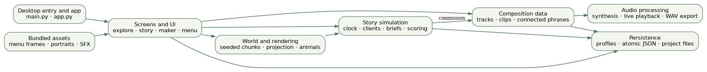
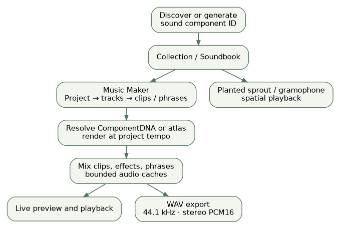

# Architecture — Bal's Sound Garden

Bal's Sound Garden is a Python desktop application. Its **runtime** remains under `cat_society/`; the `docs/` directory contains only website and engineering documentation.

## Application flow

`main.py` calls `cat_society.app:main`. The application object initializes the window, runtime services and screens. The Pygame event loop feeds input and screen transitions; simulation state belongs to the game, world, music and story layers rather than the static presentation website.

| Subsystem | Key files | Responsibility |
|---|---|---|
| Application and screens | `app.py`, `screens/*.py` | navigation, input routing, gameplay UIs |
| World and simulation | `world/generation.py`, `world/state.py`, `systems/*.py` | stable chunk placement, interactions, animal behavior |
| Rendering | `camera.py`, `projection.py`, `render/*.py` | 2.5D projection, atmosphere, sprites, day/night and water |
| Sound sources | `components/catalog.py`, `components/procedural.py` | finite atlas and seeded procedural components |
| Music workstation | `music/project.py`, `screens/maker.py`, `audio/*.py` | clip timeline, connected phrases, playback, WAV export |
| Story/shop | `story/clock.py`, `story/clients.py`, `story/requests.py`, `story/scoring.py` | orders, waiting clients, deadline evaluation, progression |
| Durability | `persistence.py`, `paths.py`, `music/store.py` | structured project saves and atomic replacement |

## Musical data path

Component IDs connect the explorable world to the Music Maker. A saved project stores placements, not rendered waveforms. Playback and export resolve the same components through the synthesis/mixing path. Legacy procedural identifiers remain supported to reconstruct older saves.

## Determinism and real time

Chunk positions are keyed by seed and coordinates; independent random streams keep scenery changes from perturbing gameplay placement. The story clock advances independently of spatial movement, including while composing. Deadlines use monotonic game-day stamps instead of display clock strings.

## Boundary rules

- This is **not** a web game. GitHub Pages serves only the project explanation; Python/Pygame provides the desktop runtime.
- Test scripts and static website files are not imported into the playable application.
- Sound exports and player save files are generated data and must stay out of source-control commits.
- No source modules were split, moved or changed in the source-cleanup release.

Full implementation details and limitations: [Technical report](TECHNICAL_REPORT.pdf).
